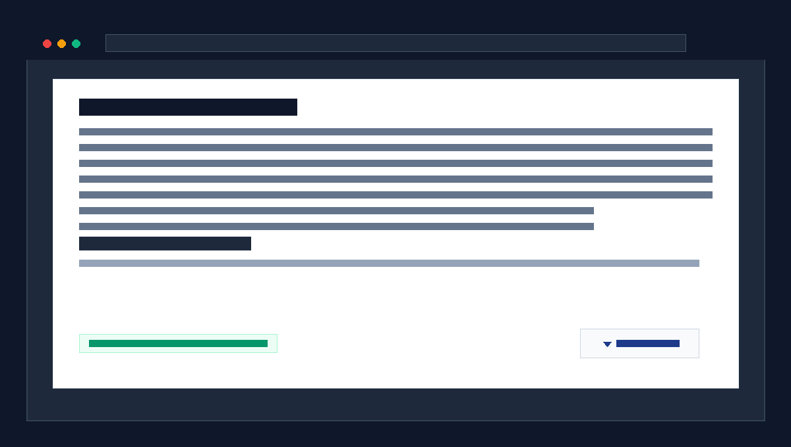

# Woo Category Read More & Extra Description Clamper (WordPress Plugin)

> **افزونه هوشمند، فوق‌سبک و سئومحور ووکامرس برای ایجاد دکمه «مشاهده بیشتر / نمایش کمتر» روی توضیحات تکمیلی (Extra Description وودمارت و رنک‌مث) یا توضیحات دسته‌بندی ووکامرس بدون دستکاری سورس HTML اولیه موتورهای جستجو.**



---

## 🎯 مسأله و هدف افزونه (The Problem & Solution)

در بسیاری از فروشگاه‌های ووکامرسی حرفه‌ای (مخصوصاً سایت‌هایی که از قالب **Woodmart**، صفحه‌ساز **Elementor** یا پلاگین سئوی **Rank Math** استفاده می‌کنند):
1. در انتهای صفحات آرشیو دسته‌بندی محصولات، متن‌های سئویی طولانی (شامل معرفی جامع، هدینگ‌های H2/H3، راهنمای خرید و سوالات متداول FAQ) در بخش **توضیحات تکمیلی (Extra Description)** قرار می‌گیرد.
2. بدون تاگل مناسب، این متن طولانی ساختار بصری صفحه را شلوغ کرده و اسکرول کاربر در موبایل و دسکتاپ را خسته‌کننده می‌کند.
3. راه‌حل‌های سنتی PHP با پرینت مجدد متن، باعث ایجاد **محتوای تکراری (Duplicate Content)** و به هم ریختن چیدمان المنتور می‌شوند.
4. **این افزونه:**
   - **بدون دستکاری سورس اولیه HTML:** ربات گوگل کل محتوا و اسکیماها را با حداکثر Passage-Level Relevance در اولین رندر دریافت می‌کند.
   - **تشخیص خودکار و هوشمند:** اگر صفحه دارای **Extra Description** باشد (وودمارت، المنتور، رنک‌مث)، آن را هدف می‌گیرد. اگر نباشد، سراغ توضیحات استاندارد دسته‌بندی می‌رود.
   - **طراحی روان و سبک:** صفر وابستگی به jQuery (کاملاً Vanilla JS زیر ۳ کیلوبایت)، انیمیشن CSS نرم، گرادینت محو شونده (Fade Mask)، پشتیبانی از آکاردئون‌ها/FAQ داخل متن، و جلوگیری از پرش اسکرول کاربر هنگام بستن.

---

## ✨ ویژگی‌های کلیدی

- ⚡ **Auto-Detection (تشخیص خودکار اولویت‌دار):**
  - شناسایی هوشمند ویجت‌های المنتور وودمارت (`.elementor-widget-wd_shop_archive_extra_description`)
  - شناسایی فیلدهای اکسترا دیسکریپشن محلی وودمارت (`.wd-shop-archive-extra-description` / `.wd-term-desc`)
  - شناسایی اکسترا دیسکریپشن رنک‌مث (`.term-extra-description` / `.rank-math-extra-description`)
  - فال‌بک خودکار به توضیحات عمومی دسته‌بندی در سایر قالب‌ها (`.term-description` / `.page-description`)
- 🎨 **ماسک محو شونده پویا (Dynamic Fade Mask):** گرادینت شفاف در انتهای متن بسته برای ایجاد حس بصری طبیعی.
- 📐 **پنل تنظیمات کاربری در وردپرس:**
  - مسیر: **پیشخوان وردپرس > تنظیمات > مشاهده بیشتر دسته‌بندی**
  - تنظیم ارتفاع در حالت بسته (پیش‌فرض: ۲۲۰ پیکسل ~ معادل ۵ تا ۶ خط متن)
  - تغییر عناوین دکمه («مشاهده بیشتر» / «نمایش کمتر»)
  - شخصی‌سازی رنگ متن، رنگ پس‌زمینه، بوردر و رنگ محو شدگی (Fade)
  - قابلیت تعیین حالت هدف‌گیری: *خودکار*، *فقط اکسترا دیسکریپشن*، *فقط دیسکریپشن استاندارد* یا *هر دو*
  - پشتیبانی از افزودن کلاس‌ها و سلکتورهای سفارشی
- 🚀 **سازگار با Core Web Vitals:** بدون Layout Shift ناگهانی (CLS < 0.01) و زمان پاسخگویی آنی (0 INP Lag).
- 📱 **کاملاً ریسپانسیو:** متناسب با تاچ موبایل و مانیتورهای عریض.

---

## 📦 نحوه نصب و راه‌اندازی

### روش ۱: آپلود فایل Zip (سریع‌ترین راه)
1. فایل `woo-category-read-more.zip` موجود در این ریپازیتوری را دانلود کنید.
2. در پیشخوان وردپرس به مسیر **افزونه‌ها > افزودن افزونه > بارگذاری افزونه** بروید.
3. فایل زیپ را انتخاب و دکمه **نصب** و سپس **فعال‌سازی** را بزنید.

### روش ۲: کلون از گیت‌هاب در مسیر افزونه‌ها
```bash
cd wp-content/plugins/
git clone https://github.com/am333ni7y/woo-category-read-more.git
```
سپس افزونه را از منوی افزونه‌های وردپرس فعال کنید.

---

## ⚙️ گزینه‌های هدف‌گیری (Target Modes)

| حالت (Mode) | رفتار افزونه |
| :--- | :--- |
| **هوشمند / خودکار (Auto - پیش‌فرض)** | ابتدا وجود اکسترا دیسکریپشن بررسی می‌شود؛ در صورت وجود کلمپ روی آن اعمال می‌شود، وگرنه روی دیسکریپشن استاندارد. |
| **فقط اکسترا (Extra Only)** | فقط باکس‌های توضیحات تکمیلی وودمارت و رنک‌مث کلمپ می‌شوند. |
| **فقط استاندارد (Standard Only)** | فقط توضیحات بالای گرید / پیش‌فرض ووکامرس کلمپ می‌شود. |
| **هر دو (Both)** | اگر هر دو توضیحات در صفحه وجود داشته باشند، روی هر دو دکمه قرار می‌گیرد. |

---

## 🛠 سازگاری تست‌شده

- **قالب‌ها:** Woodmart, Astra, Hello Elementor, OceanWP, Flatsome, Enfold, و قالب‌های اختصاصی
- **صفحه‌سازها:** Elementor & Elementor Pro, Gutenberg Block Editor, WPBakery
- **افزونه‌های سئو:** Rank Math / Rank Math Pro, Yoast SEO, SEOPress
- **سیستم‌ها:** WooCommerce 5.0+ | WordPress 5.6+ | PHP 7.4 - 8.3

---

## 📄 لایسنس و حقوق نشر

- توسعه‌دهنده: **Ameeen (Amirhossein)**
- وبسایت: [Ameeen.ir](https://ameeen.ir)
- گواهینامه: **GPL v2 or later** - برای استفاده آزاد در تمام پروژه‌های اختصاصی و مشتریان.
