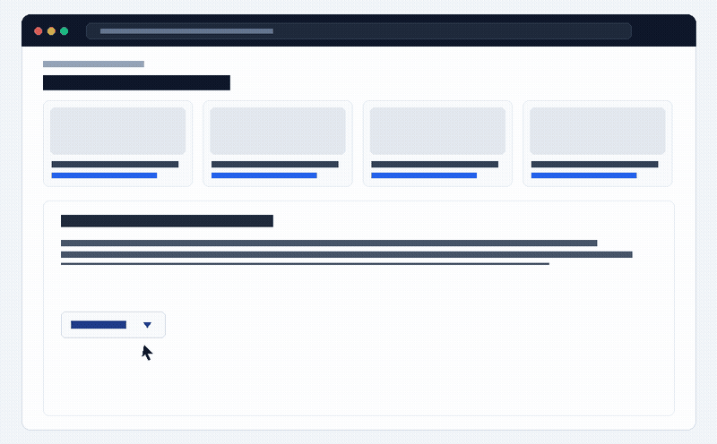
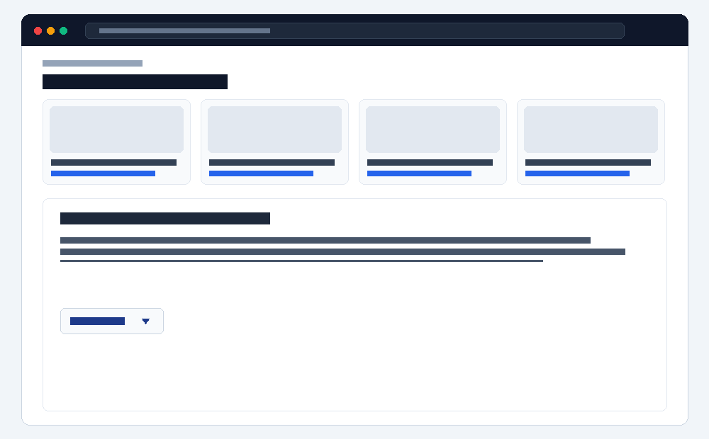
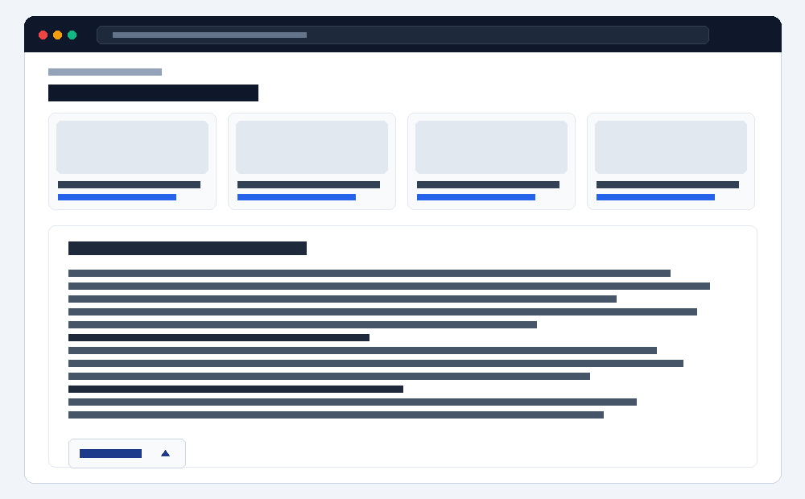
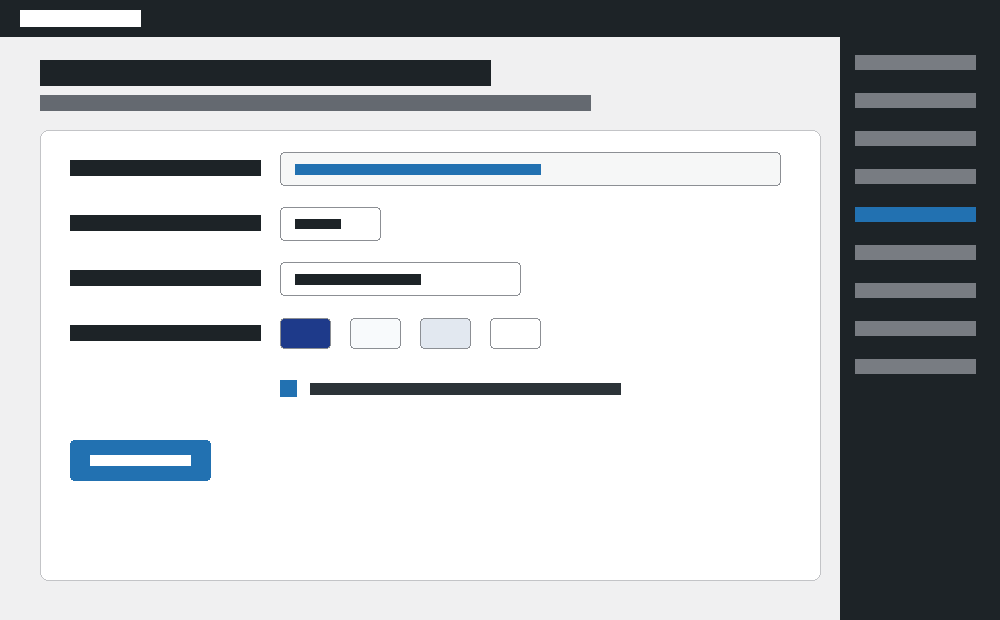

# Woo Category Read More & Extra Description Clamper

<p align="center">
  
</p>

<p align="center">
  <a href="https://github.com/am333ni7y/woo-category-read-more/releases"></a>
  <a href="https://wordpress.org"></a>
  <a href="https://woocommerce.com"></a>
  <a href="LICENSE"></a>
  <a href="https://ameeen.ir"></a>
</p>

---

## 🌐 English Documentation

### Overview
**Woo Category Read More & Extra Description Clamper** is a high-performance, ultra-lightweight, SEO-first WordPress plugin that adds an elegant, animated **"Read More / Read Less"** toggle with a smooth gradient fade mask to WooCommerce category archives.

Unlike traditional PHP reinjection scripts that echo duplicate descriptions (causing Google duplicate content penalties and breaking Elementor/Woodmart layouts), this plugin operates **directly on the existing DOM container in-place**. Googlebot and search engine crawlers index the complete raw HTML source and passage-level relevance on initial render, while human visitors enjoy a clean, compact view with no scroll fatigue.

### 🌟 Key Features
- **Smart Auto-Detection (Priority Hierarchy):**
  - Detects **Extra Description** (Woodmart Theme, Elementor Archive templates, Rank Math SEO secondary description, etc.) first: `.elementor-widget-wd_shop_archive_extra_description`, `.wd-shop-archive-extra-description`, `.wd-term-desc`, `.term-extra-description`.
  - Seamlessly falls back to standard WooCommerce category description (`.term-description`, `.page-description`) if no extra description is present.
- **Zero jQuery Dependency:** Written in 100% pure modern Vanilla JavaScript (< 3KB). Zero blocking threads, 0 INP lag, and CLS < 0.01 for perfect Core Web Vitals.
- **Dynamic Gradient Fade Mask:** Automatically generates a smooth fade overlay on the bottom of the clamped text box.
- **Accordion / FAQ Friendly:** Seamlessly handles internal `<details>` FAQ accordions, tabs, and late-loading images without content clipping.
- **Anti-Jump Smooth Scrolling:** If a visitor reads through an expanded text and clicks "Read Less", the viewport gently scrolls back to the top of the box.
- **Dedicated WordPress Admin Dashboard:** Customize collapsed height, button labels, colors, fade gradient, targeting modes, and custom CSS selectors.

---

### 📸 Screenshots & UI Preview

| 1. Clamped View (Fade Mask + Button) | 2. Expanded View (Full SEO & FAQ Content) |
| :---: | :---: |
|  |  |

| 3. WordPress Admin Settings Panel |
| :---: |
|  |

---

### 🚀 Installation

#### Method 1: Upload via WordPress Admin (Recommended)
1. Download `woo-category-read-more.zip` from this repository.
2. Go to **WordPress Admin > Plugins > Add New > Upload Plugin**.
3. Choose the `.zip` file and click **Install Now**, then **Activate**.

#### Method 2: Clone via Git
```bash
cd wp-content/plugins/
git clone https://github.com/am333ni7y/woo-category-read-more.git
```
Then activate the plugin from the WordPress Plugins screen.

---

### ⚙️ Settings & Configuration
Navigate to **WordPress Admin > Settings > Category Read More** (تنظیمات > مشاهده بیشتر دسته‌بندی):

- **Target Mode:**
  - `Auto (Recommended)`: Prioritizes Extra Description (Woodmart / Elementor / Rank Math); falls back to standard Category Description.
  - `Extra Only`: Only clamps extra description containers.
  - `Standard Only`: Only clamps default category description.
  - `Both`: Clamps both if both exist on the same page.
- **Collapsed Height (px):** Default `220px` (~5-6 lines of text).
- **Button Labels:** Customize open and closed states (e.g., "Read More" / "Read Less" or "مشاهده بیشتر" / "نمایش کمتر").
- **Color Scheme:** Fully customizable button text, background, border, and fade mask gradient color.
- **Auto-Scroll on Collapse:** Toggles smooth viewport restoration.
- **Custom Selectors:** Add arbitrary comma-separated CSS selectors for niche custom themes.

---

## 🇮🇷 راهنمای فارسی (Persian Documentation)

### معرفی و هدف افزونه
در بسیاری از فروشگاه‌های ووکامرسی حرفه‌ای (به‌ویژه سایت‌هایی که از قالب **Woodmart**، صفحه‌ساز **Elementor** یا پلاگین **Rank Math** استفاده می‌کنند)، متن‌های سئویی طولانی در بخش **توضیحات تکمیلی (Extra Description)** در پایین صفحه قرار می‌گیرند.

این افزونه بدون دستکاری سورس اولیه HTML (جهت تضمین ۱۰۰٪ ایندکس سئو توسط گوگل) و بدون تولید محتوای تکراری در PHP، مستقیماً همان کانتینر موجود در صفحه را به شکل هوشمند تشخیص داده و با گرادینت محو شونده (Fade Mask) و دکمه روان کلمپ می‌کند.

### ✨ مزایای اصلی
1. **اولویت‌بندی خودکار (Auto-Detection):** اگر اکسترا دیسکریپشن وودمارت یا رنک‌مث وجود داشته باشد، همان ریدمور می‌شود. اگر نباشد، توضیحات استاندارد دسته‌بندی ریدمور می‌شود.
2. **سئوی امن:** سورس اولیه HTML برای گوگل‌بات و موتورهای جستجو کاملاً باز و خواناست و اسکیماها و Passage-Level Relevance دست‌نخورده باقی می‌مانند.
3. **پرفورمنس بالا:** صفر وابستگی به jQuery، حجم کمتر از ۳ کیلوبایت Vanilla JS، و سازگار کامل با Core Web Vitals.
4. **پنل مدیریت جامع:** تنظیم رنگ‌ها، گرادینت، ارتفاع بسته (پیکسل)، و متن دکمه‌ها در منوی **تنظیمات > مشاهده بیشتر دسته‌بندی**.

---

## 🏷️ Keywords & Topics
`woocommerce`, `wordpress`, `read-more`, `category-description`, `extra-description`, `woodmart`, `elementor`, `rank-math`, `seo`, `core-web-vitals`, `vanilla-js`, `wordpress-plugin`, `term-description`, `faq-accordion`

---

## 👨‍💻 Author & Publisher
- **Publisher / Author:** **AMEEEN (Amin Zahed)**
- **Website:** [https://ameeen.ir](https://ameeen.ir)
- **GitHub:** [@am333ni7y](https://github.com/am333ni7y)

## 📄 License
This plugin is licensed under the [GNU General Public License v2.0 or later](LICENSE).
